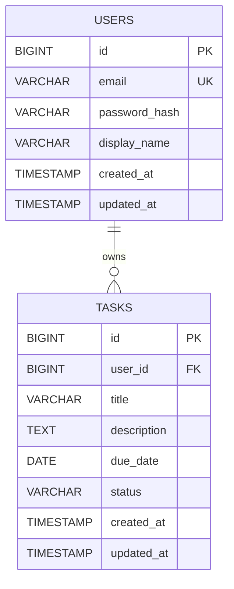

# Thiết kế cấu trúc cơ sở dữ liệu

## 1. Sơ đồ thực thể và quan hệ (ERD)

Sơ đồ ERD thể hiện quan hệ 1-N giữa hai bảng users và tasks.



## 2. Mô tả cấu trúc bảng

### 2.1. Bảng users

| Cột | Kiểu | NULL | Mặc định | Ghi chú |
|---|---|---|---|---|
| id | BIGINT AUTO_INCREMENT | NOT NULL | Tự tăng | Khóa chính |
| email | VARCHAR(255) | NOT NULL | – | Email đăng nhập |
| password_hash | VARCHAR(255) | NOT NULL | – | Mật khẩu đã hash |
| display_name | VARCHAR(100) | NULL | – | Tên hiển thị |
| created_at | TIMESTAMP | NOT NULL | CURRENT_TIMESTAMP | Ngày tạo |
| updated_at | TIMESTAMP | NOT NULL | CURRENT_TIMESTAMP | Ngày cập nhật |

### 2.2. Bảng tasks

| Cột | Kiểu | NULL | Mặc định | Ghi chú |
|---|---|---|---|---|
| id | BIGINT, identity | NOT NULL | Tự tăng | Khóa chính |
| user_id | BIGINT | NOT NULL | – | FK → users.id |
| title | VARCHAR(255) | NOT NULL | – | Tên công việc |
| description | TEXT | NULL | – | Mô tả |
| due_date | DATE | NULL | – | Hạn hoàn thành |
| status | VARCHAR(20) | NOT NULL | 'pending' | Trạng thái |
| created_at | TIMESTAMP | NOT NULL | CURRENT_TIMESTAMP | Ngày tạo |
| updated_at | TIMESTAMP | NOT NULL | CURRENT_TIMESTAMP | Ngày cập nhật |

## 3. Khóa và các ràng buộc dữ liệu

### 3.1. Khóa chính (Primary Key)

Khóa chính dùng để định danh duy nhất mỗi bản ghi trong bảng.

| Bảng | Tên ràng buộc | Cột | Kiểu dữ liệu | Cách sinh | Lý do |
|---|---|---|---|---|---|
| users | pk_users | id | BIGINT | Tự tăng (IDENTITY) | Khóa đại diện (surrogate key), không thay đổi khi user đổi email |
| tasks | pk_tasks | id | BIGINT | Tự tăng (IDENTITY) | Mỗi task có định danh độc lập, dùng trong URL `/tasks/{id}` |

### 3.2. Khóa ngoại (Foreign Key)

Khóa ngoại đảm bảo tính toàn vẹn tham chiếu giữa hai bảng users và tasks.

| Tên ràng buộc | Bảng.cột (con) | Tham chiếu (cha) | ON DELETE | ON UPDATE |
|---|---|---|---|---|
| fk_tasks_user | tasks.user_id (NOT NULL) | users.id | CASCADE | RESTRICT |

**Giải thích:**

- Quan hệ 1-N: Một user có thể sở hữu 0 hoặc nhiều task, mỗi task thuộc đúng một user.
- `user_id` là NOT NULL nên không tồn tại task không có chủ sở hữu.
- `ON DELETE CASCADE`: Khi xóa một user, toàn bộ task thuộc user đó sẽ tự động bị xóa.
- `ON UPDATE RESTRICT`: Không cho phép thay đổi ID của user khi vẫn còn task tham chiếu đến ID đó.
- Index trên `tasks.user_id` được hỗ trợ bởi `idx_tasks_user_status_due` vì `user_id` là cột đầu tiên trong index.

### 3.3. Ràng buộc duy nhất (UNIQUE)

Ràng buộc UNIQUE đảm bảo các giá trị trong cột được chỉ định không bị trùng lặp.

| Tên ràng buộc / Index | Bảng | Cột | Ghi chú |
|---|---|---|---|
| uq_users_email | users | lower(email) | Mỗi email chỉ được sử dụng cho một tài khoản |

**Giải thích:**

- Email được chuẩn hóa về chữ thường và loại bỏ khoảng trắng ở đầu, cuối bằng `trim()` trước khi lưu.
- Sử dụng unique index trên `lower(email)` để đảm bảo email không bị trùng kể cả khi khác nhau về chữ hoa, chữ thường.
- Không đặt UNIQUE cho `tasks.title`, vì nhiều công việc có thể có cùng tên.
- Khi đăng ký bằng email đã tồn tại, database trả về lỗi vi phạm UNIQUE. Backend cần bắt lỗi này và trả về HTTP `409 Conflict`, không trả về `500 Internal Server Error`.

### 3.4. Ràng buộc kiểm tra (CHECK) và NOT NULL

**Các ràng buộc CHECK:**

| Tên ràng buộc | Bảng | Điều kiện | Ý nghĩa |
|---|---|---|---|
| ck_tasks_status | tasks | `status IN ('pending', 'completed')` | Chỉ chấp nhận hai trạng thái hợp lệ |
| ck_tasks_title_not_blank | tasks | `char_length(trim(title)) > 0` | Tên công việc không được để trống hoặc chỉ chứa khoảng trắng |
| ck_users_email_not_blank | users | `char_length(trim(email)) > 0` | Email không được để trống hoặc chỉ chứa khoảng trắng |

**Các cột bắt buộc NOT NULL:**

| Bảng | Cột |
|---|---|
| users | email, password_hash, created_at, updated_at |
| tasks | user_id, title, status, created_at, updated_at |

Các cột còn lại như `display_name`, `description` và `due_date` được phép nhận giá trị NULL.

### 3.5. Xử lý dữ liệu liên quan khi xóa

| Thao tác xóa | Kết quả trong database | Dữ liệu liên quan |
|---|---|---|
| Xóa một task | Xóa đúng bản ghi task đó (hard delete) | Không ảnh hưởng đến user |
| Xóa một user | Xóa bản ghi user | Tự động xóa toàn bộ task của user theo ON DELETE CASCADE |
| Xóa task khi user còn tồn tại | Thực hiện bình thường | Bản ghi users được giữ nguyên |
| Tạo task với user_id không tồn tại | Bị từ chối do vi phạm khóa ngoại (FK) | Không tạo được task mồ côi |

---

## 4. Thiết kế chỉ mục (Index)

### 4.1. Các truy vấn mà index cần hỗ trợ

Các chỉ mục được thiết kế dựa trên những truy vấn chính của ứng dụng quản lý công việc.

| Mã | Truy vấn | Câu SQL điển hình |
|---|---|---|
| Q1 | Đăng nhập | `WHERE email = ?` |
| Q2 | Lấy danh sách task của user | `WHERE user_id = ? ORDER BY due_date` |
| Q3 | Lọc task theo trạng thái | `WHERE user_id = ? AND status = ? ORDER BY due_date` |
| Q4 | Xem, sửa, xóa một task | `WHERE id = ? AND user_id = ?` |
| Q5 | Xóa user và các task liên quan | Database tìm các task con thông qua `user_id` khi thực hiện CASCADE |

### 4.2. Danh sách chỉ mục

| Tên index | Bảng | Cột (theo thứ tự) | Loại | Truy vấn phục vụ | Mức độ cần thiết |
|---|---|---|---|---|---|
| PRIMARY KEY | users | id | B-tree | Định danh user | Bắt buộc (tự tạo) |
| uq_users_email | users | lower(email) | UNIQUE B-tree | Q1, chống trùng email | Bắt buộc |
| PRIMARY KEY | tasks | id | B-tree | Q4 | Bắt buộc (tự tạo) |
| idx_tasks_user_status_due | tasks | user_id, status, due_date | B-tree | Q3, Q5 và hỗ trợ truy vấn theo user_id | Bắt buộc |
| idx_tasks_user_due | tasks | user_id, due_date | B-tree | Q2 | Tùy chọn |

**Giải thích lựa chọn index:**

- **uq_users_email:** Giúp tìm kiếm tài khoản theo email nhanh hơn khi đăng nhập, đồng thời đảm bảo mỗi email chỉ thuộc về một tài khoản.
- **PRIMARY KEY trên users.id và tasks.id:** Được database tự động tạo index để đảm bảo định danh duy nhất và hỗ trợ truy vấn theo ID.
- **idx_tasks_user_status_due:** Hỗ trợ lọc công việc theo user và trạng thái, đồng thời sắp xếp theo due_date. Index này cũng hỗ trợ truy vấn theo user_id và việc tìm task liên quan khi xóa user.
- **idx_tasks_user_due:** Hỗ trợ lấy danh sách công việc của một user và sắp xếp theo due_date mà không cần lọc theo status. Đây là index tùy chọn, có thể bổ sung khi truy vấn Q2 thường xuyên được sử dụng.

Lưu ý: Index `idx_tasks_user_status_due` không thay thế hoàn toàn `idx_tasks_user_due` vì cột `status` nằm giữa `user_id` và `due_date`.

### 4.3. Câu lệnh SQL tham khảo

Các câu lệnh dưới đây minh họa cách tạo index trên MySQL, dùng để tài liệu hóa thiết kế, không phải migration thực tế.

**Bảng users:**

```sql
-- Unique index cho email
CREATE UNIQUE INDEX uq_users_email
ON users (email);
```

**Bảng tasks:**

```sql
-- Index phục vụ lọc theo user và trạng thái
CREATE INDEX idx_tasks_user_status_due
ON tasks (user_id, status, due_date);

-- Index tùy chọn phục vụ danh sách task theo hạn hoàn thành
CREATE INDEX idx_tasks_user_due
ON tasks (user_id, due_date);
```
