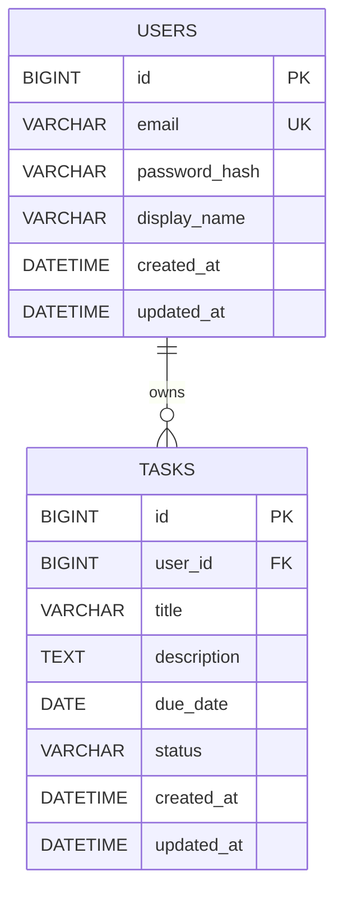

# Thiết kế cấu trúc cơ sở dữ liệu

**Task:** CLOUD-5  
**Database:** MySQL 8.0.16 trở lên, engine InnoDB  
**Đối chiếu với:** API Specification CLOUD-38 (v1)

## 0. Môi trường và quy ước chung

| Hạng mục | Quy ước | Lý do |
|---|---|---|
| Phiên bản MySQL | 8.0.16 trở lên | Từ phiên bản này ràng buộc `CHECK` mới được thực thi; các bản cũ chấp nhận cú pháp nhưng bỏ qua |
| Storage engine | InnoDB | Hỗ trợ khóa ngoại và transaction |
| Character set | `utf8mb4` | Lưu được tiếng Việt và ký tự Unicode đầy đủ |
| Collation mặc định | `utf8mb4_0900_ai_ci` | Không phân biệt hoa thường, nên `UNIQUE` trên `email` đã chống trùng khác hoa thường |
| Kiểu thời gian | `DATETIME`, lưu giá trị UTC | Thống nhất với API; không phụ thuộc múi giờ của session như `TIMESTAMP` |
| Múi giờ kết nối | `time_zone = '+00:00'` (UTC) | Để `CURRENT_TIMESTAMP` trong `DEFAULT` và `ON UPDATE` cũng ra giờ UTC |
| Cách sinh khóa chính | `AUTO_INCREMENT` | Cơ chế tự tăng của MySQL |

**Quy ước thời gian:** `DATETIME` không lưu thông tin múi giờ. Hệ thống quy ước mọi giá trị trong `created_at` và `updated_at` là UTC. Có hai điều kiện để quy ước này đúng:

1. Kết nối từ backend đến MySQL đặt múi giờ UTC (tùy chọn kết nối của driver, hoặc `default-time-zone='+00:00'` trong cấu hình MySQL/Docker).
2. Backend đọc giá trị `DATETIME` và diễn giải là UTC, rồi trả ra API dạng ISO 8601 có hậu tố `Z`.

## 1. Sơ đồ thực thể và quan hệ (ERD)

Sơ đồ ERD thể hiện quan hệ 1-N giữa hai bảng users và tasks.



## 2. Mô tả cấu trúc bảng

### 2.1. Bảng users

| Cột | Kiểu | NULL | Mặc định | Ghi chú |
|---|---|---|---|---|
| id | BIGINT AUTO_INCREMENT | NOT NULL | Tự tăng | Khóa chính |
| email | VARCHAR(255) | NOT NULL | – | Email đăng nhập, đã trim và chuyển chữ thường ở backend |
| password_hash | VARCHAR(255) | NOT NULL | – | Mật khẩu đã hash (bcrypt hoặc Argon2) |
| display_name | VARCHAR(100) | NULL | – | Tên hiển thị |
| created_at | DATETIME | NOT NULL | CURRENT_TIMESTAMP | Thời điểm tạo (UTC) |
| updated_at | DATETIME | NOT NULL | CURRENT_TIMESTAMP, ON UPDATE CURRENT_TIMESTAMP | Thời điểm cập nhật (UTC) |

### 2.2. Bảng tasks

| Cột | Kiểu | NULL | Mặc định | Ghi chú |
|---|---|---|---|---|
| id | BIGINT AUTO_INCREMENT | NOT NULL | Tự tăng | Khóa chính |
| user_id | BIGINT | NOT NULL | – | FK → users.id |
| title | VARCHAR(255) | NOT NULL | – | Tên công việc |
| description | TEXT | NULL | – | Mô tả (API giới hạn 10.000 ký tự) |
| due_date | DATE | NULL | – | Hạn hoàn thành, không có giờ |
| status | VARCHAR(20) COLLATE utf8mb4_bin | NOT NULL | 'pending' | Trạng thái; collation `_bin` để so sánh phân biệt hoa thường |
| created_at | DATETIME | NOT NULL | CURRENT_TIMESTAMP | Thời điểm tạo (UTC) |
| updated_at | DATETIME | NOT NULL | CURRENT_TIMESTAMP, ON UPDATE CURRENT_TIMESTAMP | Thời điểm cập nhật (UTC) |

**Về `updated_at`:** `ON UPDATE CURRENT_TIMESTAMP` chỉ làm `updated_at` thay đổi khi có ít nhất một cột khác thực sự đổi giá trị. Gửi lại đúng giá trị cũ thì `updated_at` giữ nguyên, khớp với quy tắc của API.

**Về độ dài `description`:** `TEXT` chứa tối đa 65.535 byte. Với `utf8mb4`, 10.000 ký tự tối đa 40.000 byte nên giới hạn 10.000 ký tự của API luôn nằm trong sức chứa của cột.

## 3. Khóa và các ràng buộc dữ liệu

### 3.1. Khóa chính (Primary Key)

Khóa chính dùng để định danh duy nhất mỗi bản ghi trong bảng.

| Bảng | Tên ràng buộc | Cột | Kiểu dữ liệu | Cách sinh | Lý do |
|---|---|---|---|---|---|
| users | pk_users | id | BIGINT | AUTO_INCREMENT | Khóa đại diện (surrogate key), không thay đổi khi user đổi email |
| tasks | pk_tasks | id | BIGINT | AUTO_INCREMENT | Mỗi task có định danh độc lập, dùng trong URL `/tasks/{id}` |

**Lưu ý MySQL:** MySQL luôn đặt tên khóa chính là `PRIMARY` và bỏ qua tên do người dùng đặt. Các tên `pk_users`, `pk_tasks` chỉ có tác dụng làm tài liệu.

### 3.2. Khóa ngoại (Foreign Key)

Khóa ngoại đảm bảo tính toàn vẹn tham chiếu giữa hai bảng users và tasks.

| Tên ràng buộc | Bảng.cột (con) | Tham chiếu (cha) | ON DELETE | ON UPDATE |
|---|---|---|---|---|
| fk_tasks_user | tasks.user_id (NOT NULL) | users.id | CASCADE | RESTRICT |

**Giải thích:**

- Quan hệ 1-N: Một user có thể sở hữu 0 hoặc nhiều task, mỗi task thuộc đúng một user.
- `user_id` là NOT NULL nên không tồn tại task không có chủ sở hữu.
- `ON DELETE CASCADE`: Khi xóa một user, toàn bộ task thuộc user đó sẽ tự động bị xóa.
- `ON UPDATE RESTRICT`: Không cho phép thay đổi ID của user khi vẫn còn task tham chiếu đến ID đó.
- Kiểu dữ liệu của `tasks.user_id` và `users.id` phải giống hệt nhau (cùng `BIGINT`, cùng signed/unsigned), nếu không MySQL từ chối tạo khóa ngoại.
- InnoDB yêu cầu cột khóa ngoại phải có index với `user_id` là cột đầu tiên. Index `idx_tasks_user_status_due` đáp ứng yêu cầu này nên không cần index riêng cho `user_id`.
- Khi tạo task với `user_id` không tồn tại, MySQL trả lỗi `1452`. Backend cần xử lý lỗi này theo API (xem tài liệu CLOUD-38, mục 4).

### 3.3. Ràng buộc duy nhất (UNIQUE)

Ràng buộc UNIQUE đảm bảo các giá trị trong cột được chỉ định không bị trùng lặp.

| Tên ràng buộc / Index | Bảng | Cột | Ghi chú |
|---|---|---|---|
| uq_users_email | users | email | Mỗi email chỉ được sử dụng cho một tài khoản |

**Giải thích:**

- Email được chuẩn hóa về chữ thường và loại bỏ khoảng trắng ở đầu, cuối bằng `trim()` trước khi lưu.
- MySQL không cần index trên `lower(email)`. Collation mặc định `utf8mb4_0900_ai_ci` không phân biệt hoa thường, nên `UNIQUE (email)` đã từ chối `An@Example.com` khi `an@example.com` đã tồn tại. Cách này đơn giản hơn functional index và không phụ thuộc cú pháp riêng của MySQL 8.0.13 trở lên.
- Collation này cũng không phân biệt dấu. Với email, điều này không gây vấn đề vì email thực tế dùng ký tự ASCII.
- Không đặt UNIQUE cho `tasks.title`, vì nhiều công việc có thể có cùng tên.
- Khi đăng ký bằng email đã tồn tại, MySQL trả lỗi `1062` (duplicate entry). Backend cần bắt lỗi này và trả về HTTP `409 Conflict` với mã `EMAIL_ALREADY_EXISTS`, không trả về `500 Internal Server Error`.

### 3.4. Ràng buộc kiểm tra (CHECK) và NOT NULL

**Các ràng buộc CHECK:**

| Tên ràng buộc | Bảng | Điều kiện | Ý nghĩa |
|---|---|---|---|
| ck_tasks_status | tasks | `status IN ('pending', 'completed')` | Chỉ chấp nhận hai trạng thái hợp lệ |
| ck_tasks_title_not_blank | tasks | `CHAR_LENGTH(TRIM(title)) > 0` | Tên công việc không được để trống hoặc chỉ chứa khoảng trắng |
| ck_users_email_not_blank | users | `CHAR_LENGTH(TRIM(email)) > 0` | Email không được để trống hoặc chỉ chứa khoảng trắng |

**Lưu ý MySQL:**

- `CHECK` chỉ được thực thi từ MySQL 8.0.16. Trên bản cũ hơn, ràng buộc bị bỏ qua mà không báo lỗi.
- Cột `status` dùng collation `utf8mb4_bin` để `CHECK` phân biệt hoa thường. Nếu dùng collation mặc định (không phân biệt hoa thường), giá trị `'PENDING'` vẫn vượt qua được `status IN ('pending', 'completed')`.

**Các cột bắt buộc NOT NULL:**

| Bảng | Cột |
|---|---|
| users | email, password_hash, created_at, updated_at |
| tasks | user_id, title, status, created_at, updated_at |

Các cột còn lại như `display_name`, `description` và `due_date` được phép nhận giá trị NULL.

### 3.5. Xử lý dữ liệu liên quan khi xóa

| Thao tác xóa | Kết quả trong database | Dữ liệu liên quan |
|---|---|---|
| Xóa một task | Xóa đúng bản ghi task đó (hard delete) | Không ảnh hưởng đến user |
| Xóa một user | Xóa bản ghi user | Tự động xóa toàn bộ task của user theo ON DELETE CASCADE |
| Xóa task khi user còn tồn tại | Thực hiện bình thường | Bản ghi users được giữ nguyên |
| Tạo task với user_id không tồn tại | Bị từ chối do vi phạm khóa ngoại (lỗi `1452`) | Không tạo được task mồ côi |

---

## 4. Thiết kế chỉ mục (Index)

### 4.1. Các truy vấn mà index cần hỗ trợ

Các chỉ mục được thiết kế dựa trên những truy vấn chính của ứng dụng quản lý công việc. Truy vấn Q2 và Q3 dùng đúng thứ tự sắp xếp của API (công việc không có hạn nằm cuối, cùng hạn thì theo `id`).

| Mã | Truy vấn | Câu SQL điển hình |
|---|---|---|
| Q1 | Đăng nhập | `WHERE email = ?` |
| Q2 | Lấy danh sách task của user | `WHERE user_id = ? ORDER BY due_date IS NULL, due_date, id` |
| Q3 | Lọc task theo trạng thái | `WHERE user_id = ? AND status = ? ORDER BY due_date IS NULL, due_date, id` |
| Q4 | Xem, sửa, xóa một task | `WHERE id = ? AND user_id = ?` |
| Q5 | Xóa user và các task liên quan | Database tìm các task con thông qua `user_id` khi thực hiện CASCADE |

### 4.2. Danh sách chỉ mục

| Tên index | Bảng | Cột (theo thứ tự) | Loại | Truy vấn phục vụ | Mức độ cần thiết |
|---|---|---|---|---|---|
| PRIMARY KEY | users | id | B-tree | Định danh user | Bắt buộc (tự tạo) |
| uq_users_email | users | email | UNIQUE B-tree | Q1, chống trùng email | Bắt buộc |
| PRIMARY KEY | tasks | id | B-tree | Q4 | Bắt buộc (tự tạo) |
| idx_tasks_user_status_due | tasks | user_id, status, due_date | B-tree | Q3, Q5 và hỗ trợ truy vấn theo user_id | Bắt buộc |
| idx_tasks_user_due | tasks | user_id, due_date | B-tree | Q2 | Tùy chọn |

**Giải thích lựa chọn index:**

- **uq_users_email:** Giúp tìm kiếm tài khoản theo email nhanh hơn khi đăng nhập, đồng thời đảm bảo mỗi email chỉ thuộc về một tài khoản.
- **PRIMARY KEY trên users.id và tasks.id:** Được database tự động tạo index để đảm bảo định danh duy nhất và hỗ trợ truy vấn theo ID.
- **idx_tasks_user_status_due:** Hỗ trợ lọc công việc theo user và trạng thái, đồng thời đã sắp xếp sẵn theo `due_date`. Index này cũng hỗ trợ truy vấn theo `user_id` và việc tìm task liên quan khi xóa user.
- **idx_tasks_user_due:** Hỗ trợ lấy danh sách công việc của một user và sắp xếp theo `due_date` mà không cần lọc theo status. Đây là index tùy chọn, có thể bổ sung khi truy vấn Q2 thường xuyên được sử dụng.

Lưu ý: Index `idx_tasks_user_status_due` không thay thế hoàn toàn `idx_tasks_user_due` vì cột `status` nằm giữa `user_id` và `due_date`.

**Lưu ý về `filesort`:** Mỗi index secondary của InnoDB tự động chứa thêm cột khóa chính `id` ở cuối. Tuy nhiên, vì Q2 và Q3 sắp xếp theo biểu thức `due_date IS NULL`, MySQL không thể dùng hoàn toàn thứ tự của index và có thể phải thực hiện `filesort` trên tập kết quả của một user. Với quy mô dữ liệu của project, đây là đánh đổi được chấp nhận (xem CLOUD-38, mục 7.1). Index vẫn có tác dụng thu hẹp tập dữ liệu theo `user_id` và `status` trước khi sắp xếp. Khi kiểm thử index, dùng `EXPLAIN` để xác nhận truy vấn dùng đúng index và ghi nhận việc có `Using filesort` trong kết quả.

### 4.3. Câu lệnh SQL tham khảo

Các câu lệnh dưới đây là định nghĩa MySQL đầy đủ của thiết kế, dùng để tài liệu hóa và đối chiếu khi viết migration. Chúng không thay thế file migration thực tế của project.

```sql
CREATE TABLE users (
    id            BIGINT       NOT NULL AUTO_INCREMENT,
    email         VARCHAR(255) NOT NULL,
    password_hash VARCHAR(255) NOT NULL,
    display_name  VARCHAR(100) NULL,
    created_at    DATETIME     NOT NULL DEFAULT CURRENT_TIMESTAMP,
    updated_at    DATETIME     NOT NULL DEFAULT CURRENT_TIMESTAMP
                               ON UPDATE CURRENT_TIMESTAMP,
    CONSTRAINT pk_users PRIMARY KEY (id),
    CONSTRAINT uq_users_email UNIQUE (email),
    CONSTRAINT ck_users_email_not_blank
        CHECK (CHAR_LENGTH(TRIM(email)) > 0)
) ENGINE = InnoDB
  DEFAULT CHARSET = utf8mb4
  COLLATE = utf8mb4_0900_ai_ci;

CREATE TABLE tasks (
    id          BIGINT       NOT NULL AUTO_INCREMENT,
    user_id     BIGINT       NOT NULL,
    title       VARCHAR(255) NOT NULL,
    description TEXT         NULL,
    due_date    DATE         NULL,
    status      VARCHAR(20)  COLLATE utf8mb4_bin NOT NULL DEFAULT 'pending',
    created_at  DATETIME     NOT NULL DEFAULT CURRENT_TIMESTAMP,
    updated_at  DATETIME     NOT NULL DEFAULT CURRENT_TIMESTAMP
                             ON UPDATE CURRENT_TIMESTAMP,
    CONSTRAINT pk_tasks PRIMARY KEY (id),
    CONSTRAINT fk_tasks_user FOREIGN KEY (user_id)
        REFERENCES users (id)
        ON DELETE CASCADE
        ON UPDATE RESTRICT,
    CONSTRAINT ck_tasks_status
        CHECK (status IN ('pending', 'completed')),
    CONSTRAINT ck_tasks_title_not_blank
        CHECK (CHAR_LENGTH(TRIM(title)) > 0),
    -- Phục vụ Q3, Q5 và làm index cho khóa ngoại user_id
    INDEX idx_tasks_user_status_due (user_id, status, due_date),
    -- Tùy chọn, phục vụ Q2
    INDEX idx_tasks_user_due (user_id, due_date)
) ENGINE = InnoDB
  DEFAULT CHARSET = utf8mb4
  COLLATE = utf8mb4_0900_ai_ci;
```

**Cấu hình múi giờ UTC** (một trong hai cách):

```sql
-- Cách 1: đặt cho từng kết nối (thường cấu hình trong driver của backend)
SET time_zone = '+00:00';
```

```ini
# Cách 2: đặt cho cả MySQL server (my.cnf hoặc tham số của container)
[mysqld]
default-time-zone = '+00:00'
```
